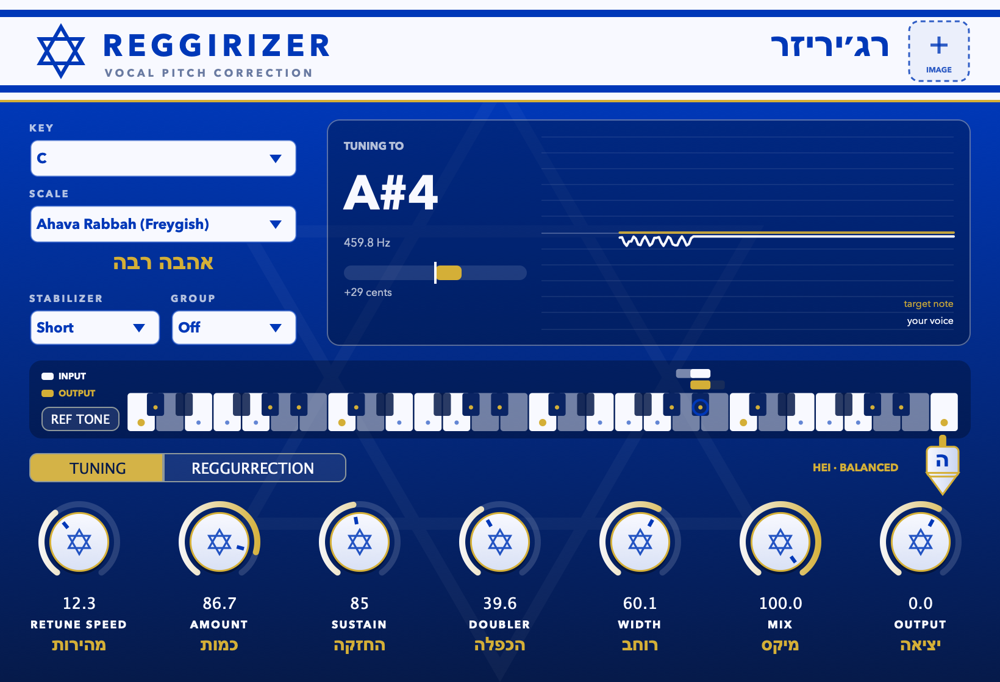
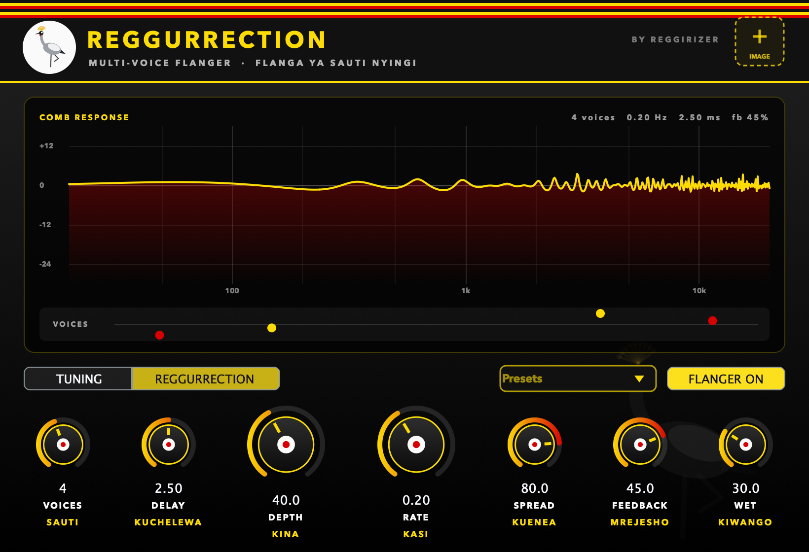

# Reggirizer

Vocal pitch correction with Jewish prayer modes, plus **REGGURRECTION**, a multi-voice flanger. VST3 for Windows and Mac, AU for Mac.




## Download

Go to **Releases** (right-hand side of this page), open the latest one, and download the zip for your computer. Install steps are in `INSTALL.txt` inside the zip.

## Features

- **Tuning:** key + scale snapping (Chromatic, Major, Minor, Ahava Rabbah/Freygish, Mi Sheberach, Magen Avot, Adonai Malach), retune speed from -3 ms (look-ahead hard lock) to 400 ms, amount, note stabilizer, sustain, doubler with width, mix, output, reference tone, instance groups, input/output heatmap keyboard.
- **Dreidel:** spin it for a random tuning in one of four styles (Nun, Gimel, Hei, Shin).
- **REGGURRECTION:** 1-8 voice stereo flanger with depth, rate, delay, spread, +/- feedback, wet, a live comb-response display and presets.
- **Your artwork:** load any image into the header.

## Building yourself

Needs CMake and [JUCE 8.0.10](https://github.com/juce-framework/JUCE) cloned into `JUCE/`.

```
cmake -S . -B build -DCMAKE_BUILD_TYPE=Release
cmake --build build --config Release
```

On Windows you can also double-click `build-windows.bat`.

Built with JUCE (AGPLv3 / JUCE licence).
